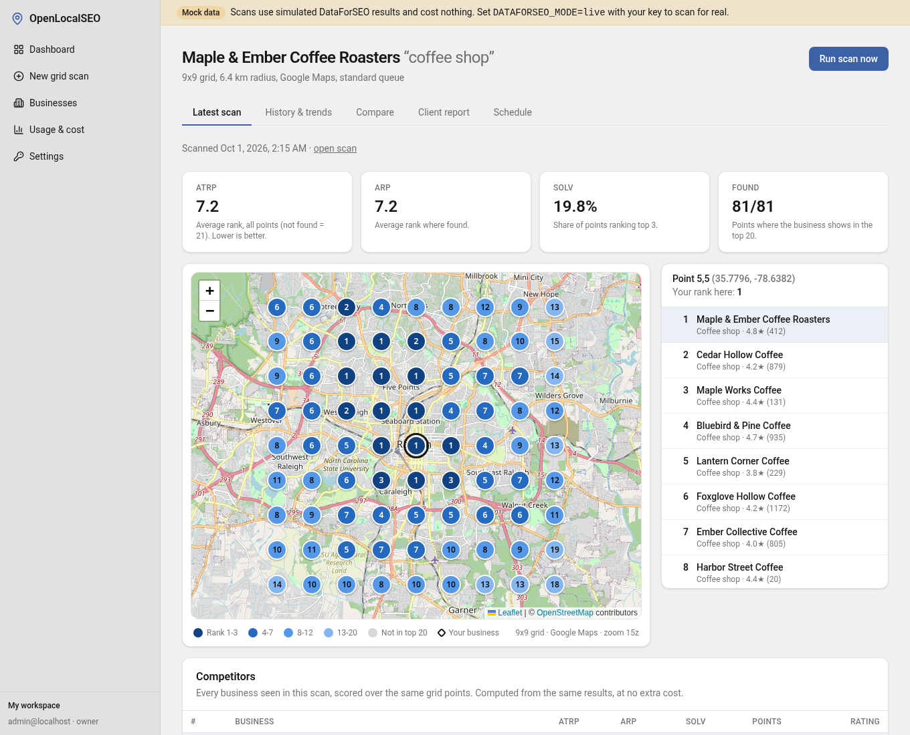
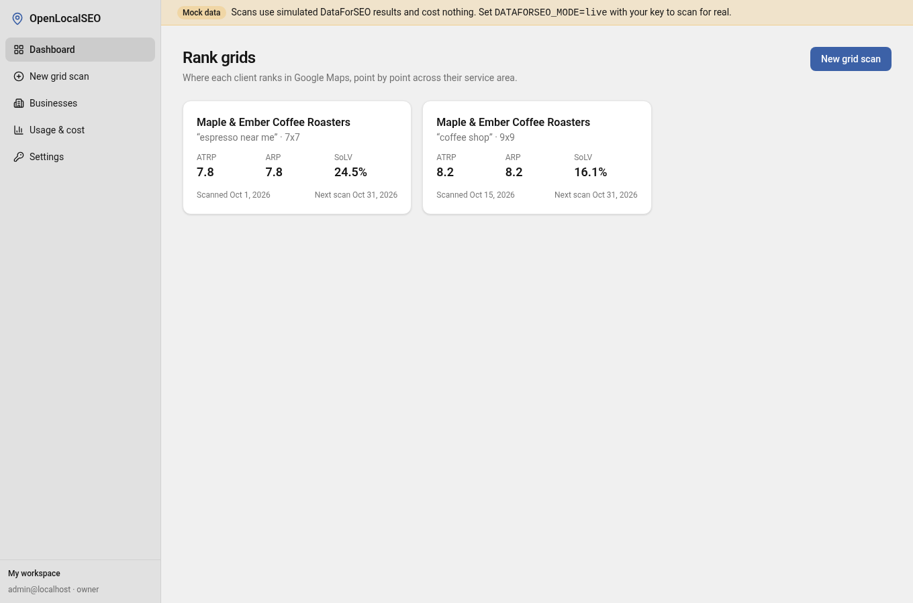
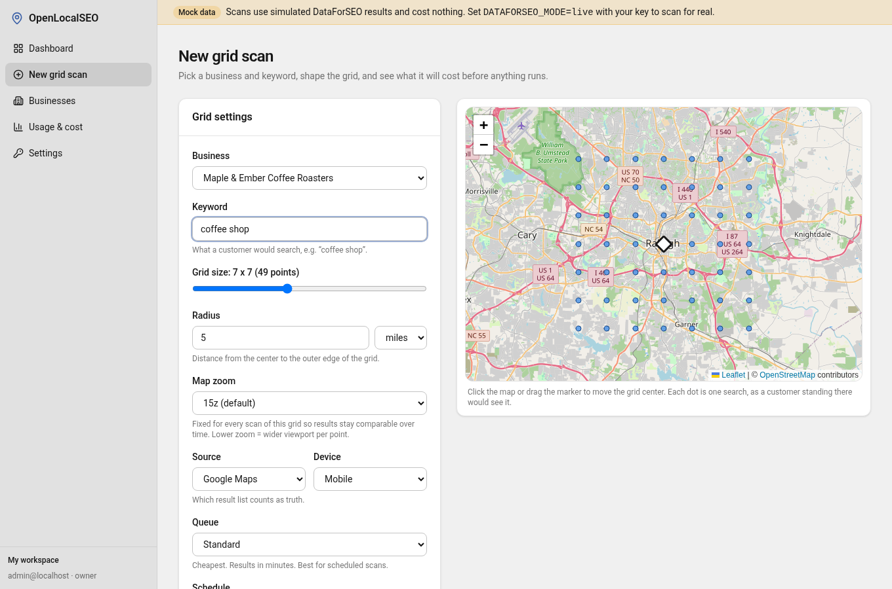
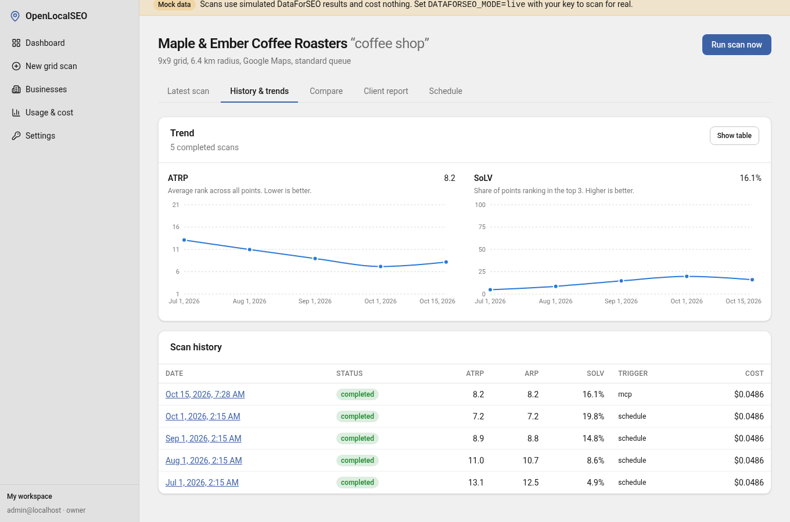
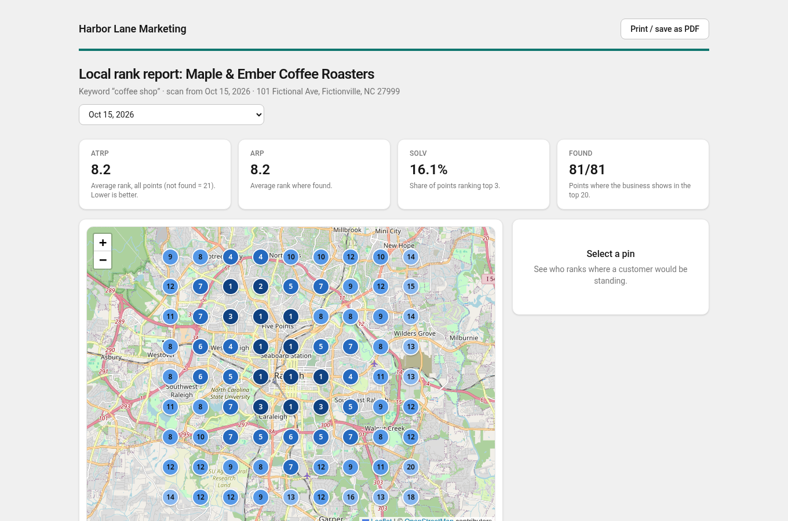

# OpenLocalSEO

An open-source **local SEO map-grid rank tracker**: see where a business shows up in Google Maps, point by point across its service area, the way Local Falcon or Local Dominator do, on infrastructure you control.



- **Grid builder**: business + keyword, 3x3 to 13x13 grid, radius in miles or km, fixed zoom, live cost estimate.
- **Scans** through DataForSEO's Google Maps and Local Finder endpoints. The Standard queue is the default (cheapest); Priority and Live are options.
- **Heatmap** on OpenStreetMap + Leaflet (no Google Maps API). Click any pin to see who ranks there.
- **Metrics**: ARP, ATRP, SoLV. **Competitor view** scored from the same SERPs, at no extra cost.
- **History**: scan list, ATRP/SoLV trend charts, side-by-side comparison of two scans.
- **Monthly scheduled scans** via Cron.
- **White-label client reports**: revocable public links with your logo, colour and footer; print to PDF.
- **Rank-drop alerts**: each finished scan is compared with the previous one; a meaningful drop raises an alert in the app, over MCP, and optionally to a Slack-compatible webhook.
- **Google Business Profile tracking** (opt-in): rating, review count, review velocity, new reviews with owner-reply status and profile health, snapshotted monthly or on demand. See [Profile & review tracking](#profile--review-tracking).
- **MCP server** (`run_scan`, `list_scans`, `get_scan`, `list_trackers`, `list_alerts`, `get_gbp_profile`, `list_reviews`) for AI assistants.
- **Bring your own key** (you pay DataForSEO directly) or **hosted cost-plus billing** (credits, DataForSEO cost + 28%). Per-call cost is recorded either way.

> **Safe by default.** Out of the box the app uses a **mock DataForSEO provider** with realistic fixtures: no API key, no network calls, no cost. Real scanning is an explicit opt-in (`DATAFORSEO_MODE=live`).

| | |
|---|---|
|  |  |
|  |  |

## Quick start (local, mock data)

Requires **Node 22+** (Wrangler's requirement).

```bash
npm install
cp .env.example .env          # defaults: mock data, local_noauth, BYOK
npm run db:reset:local        # create the local D1 database, apply migrations, load demo data
npm run dev                   # http://localhost:5173
```

The seed loads a **fictional** business ("Maple & Ember Coffee Roasters") with four months of history, branding for a fictional agency, and a public report link:
`http://localhost:5173/r/olrep_demo_maple_ember_fictional`

(The demo's map backdrop is a real city because it needs real coordinates; the business and every competitor are invented.)

Try it: **New grid scan** -> pick the business, type a keyword -> *Save & run scan*. With mock data a Standard scan finishes in about 15 seconds. Everything runs on local Wrangler/Miniflare state in `.wrangler/`. Nothing is deployed and no Cloudflare resources are created.

Other commands:

| | |
|---|---|
| `npm test` | Unit and integration tests (Vitest, real SQL against the real migrations) |
| `npm run typecheck` | `tsc --noEmit` |
| `npm run build` | Production build (`vite build` + typecheck) |
| `npm run db:migrate:local` | Apply migrations to the local D1 database |
| `npm run db:seed:local` | (Re)generate and load the demo data |

Trigger the monthly-schedule Cron locally while `npm run dev` is running:

```bash
curl -X POST "http://localhost:5173/cdn-cgi/local/explorer/api/local/scheduled?worker=openlocalseo" \
  -H 'content-type: application/json' -d '{"cron":"15 6 * * *"}'
```

## How scans work

```
UI / MCP / Cron  ->  createScan  ->  D1 (scan + points)  ->  Queue "post"
Queue "post":     one task_post per 100 points (Standard/Priority), or fan out live searches
Queue "collect":  task_get for up to 25 points, re-queues itself while tasks are pending
last point done:  metrics, credit settlement, scan = completed
```

- Every grid point is one SERP. DataForSEO bills at `task_post` time; collecting results is free.
- Every step is idempotent (queue messages can be delivered twice). A partial unique index allows only one active scan per tracker. A daily Cron also stops scans stuck in an active state and returns held credits.
- If some points fail the scan still completes: metrics cover the points that finished and the history shows a note.
- Raw SERP JSON is archived to R2 (one object per collect job); normalized results live in D1 for the heatmap and competitor view.
- The **source** (Maps or Local Finder) and **zoom** are fixed per tracker and snapshotted onto each scan, so history stays comparable (see *Accuracy* below).

### Metrics

| | Definition |
|---|---|
| **ARP** | average rank over the points where the business was found (top 20) |
| **ATRP** | average rank over all points, not-found counted as 21 |
| **SoLV** | share of points where the business ranks in the top 3 |

### Cost (DataForSEO list prices per SERP, depth <= 100)

| | Standard | Priority | Live |
|---|---|---|---|
| price per point | $0.0006 | $0.0012 | $0.002 |
| 7x7 (49 pts) | $0.0294 | $0.0588 | $0.098 |
| 13x13 (169 pts) | $0.1014 | $0.2028 | $0.338 |

These are upper-bound estimates; the real cost of each call is read from DataForSEO's response and stored in `api_calls` (Usage page). Re-check [DataForSEO pricing](https://dataforseo.com/pricing) before budgeting.

## Configuration

See [`.env.example`](.env.example) for every variable.

**Auth modes** (`AUTH_MODE`)

- `local_noauth`: local development only. The Worker refuses any non-loopback hostname in this mode, so a deployed copy left on the default is not open to the internet.
- `cloudflare_access` (default when unset): validates Cloudflare Access JWTs (`TEAM_DOMAIN`, `POLICY_AUD`). Everyone behind the Access app shares one workspace; the first person is owner.
- `hosted`: email + password accounts (PBKDF2, session cookies), multiple workspaces, member roles.

**Billing modes** (`BILLING_MODE`)

- `byok`: you pay DataForSEO directly. Costs are tracked, nothing is charged.
- `hosted`: prepaid credits (1000 credits = $1). A scan holds its marked-up estimate when created and settles on the real cost when finished (unused credits return). New workspaces get `HOSTED_FREE_CREDITS`. Top-ups use `POST /api/admin/credits` with `ADMIN_TOKEN` until a payment provider is connected.

## Self-hosting on Cloudflare

This repo never deploys or creates resources on its own. To run your own copy, do these steps yourself with your own Cloudflare account (check current Cloudflare plan limits for Queues; jobs are chunked to stay under per-invocation subrequest limits):

```bash
npx wrangler login

# 1. Create resources, then put the D1 database_id into wrangler.jsonc
npx wrangler d1 create openlocalseo
npx wrangler r2 bucket create openlocalseo
npx wrangler queues create openlocalseo-scans
npx wrangler queues create openlocalseo-scans-dlq

# 2. Protect the app with Cloudflare Access (Zero Trust -> Access -> Applications),
#    then set in wrangler.jsonc "vars":
#      "AUTH_MODE": "cloudflare_access",
#      "TEAM_DOMAIN": "https://<your-team>.cloudflareaccess.com",
#      "POLICY_AUD": "<application AUD tag>"

# 3. Go live with DataForSEO (optional; stay on mock until you are ready)
#      "DATAFORSEO_MODE": "live"
npx wrangler secret put DATAFORSEO_API_KEY     # base64 of login:password

# 4. Migrate and deploy
npm run build
npx wrangler d1 migrations apply DB --remote
npx wrangler deploy
```

The Cron (`15 6 * * *`) starts due monthly scans and Google Business Profile snapshots. MCP clients must reach `/mcp` with a bearer API key, so exclude `/mcp` from the Access policy (API keys authenticate it) or use an Access service token.

## MCP

Create an API key under **Settings -> API keys & MCP**, then:

```bash
claude mcp add --transport http openlocalseo http://localhost:5173/mcp \
  --header "Authorization: Bearer olseo_..."
```

| Tool | |
|---|---|
| `list_trackers` | saved grids with their latest result |
| `run_scan` | starts a scan; **requires `maxCostUsd`**, the amount the user approved, and refuses if the estimate is higher |
| `list_scans` | recent scans with ARP / ATRP / SoLV |
| `get_scan` | status, metrics, a rank grid (rows north to south) and top competitors |
| `list_alerts` | rank-drop, rating-drop and negative-review alerts with before/after metrics, unread first |
| `get_gbp_profile` | latest Google Business Profile snapshot of a business (rating, reviews, velocity, unanswered, health) and its history; read-only |
| `list_reviews` | stored Google reviews of a business, newest first, optionally unanswered only; read-only |

## Alerts

When a scan completes, it is compared with the tracker's previous completed scan, **only if both used the same grid size, radius, zoom, search type and keyword** (so editing a tracker never causes a false alarm). One `rank_drop` alert is raised if any of these hold (defaults, editable per workspace under **Settings -> Rank-drop alerts**):

- ATRP is worse by 2.0 or more;
- SoLV is down by 15 percentage points or more;
- found points are down by 25% of the total points or more;
- the business was in the top 3 at the center point and no longer is (odd grid sizes only).

It is `critical` when ATRP is worse by 5 or SoLV is down by 30 points, otherwise `warning`. A scan that completes with more than half of its points failed raises a separate `data_problem` alert instead (its metrics are not a reliable rank signal). Alerts are unique per scan and kind, so queue redelivery cannot duplicate them, and a failure while evaluating them is logged and never fails the scan. Alerts can be switched off per workspace.

Alerts show up under **Alerts** (with an unread count in the sidebar and on the dashboard) and via `GET /api/alerts`, `POST /api/alerts/:id/read`, `POST /api/alerts/read-all`, `GET/PUT /api/alert-settings`.

**Webhook (optional, off by default).** Set a Slack-compatible incoming webhook URL (https only) in the same settings card; each new alert sends one `POST {"text": "..."}` with a 5 second timeout. It is sent once, never retried, and a failure never affects the scan. Only workspace admins can see or change the URL.

## Profile & review tracking

Open a business (**Businesses -> Profile & reviews**) to track its Google Business Profile over time. It needs the business's Google place ID. Each snapshot records the rating, review count and star distribution, claimed status, categories, photo count, phone and website, plus the newest 20 reviews (star rating, text up to 2000 characters, date, reviewer's display name and whether the owner replied; reviewer profile links and images are never stored). From the stored snapshots it derives **new reviews since the last snapshot**, their average rating, **review velocity** (reviews per 30 days) and the **unanswered count among the newest 20**. The first snapshot is a baseline: it raises no alerts.

Tracking is **off by default**, because it spends money. Turn on **Track monthly** to snapshot on the 1st of every month from the daily Cron (enabling it spends nothing right away; use **Refresh now** for the baseline), or refresh on demand. A refresh shows its quote on the button and is refused if the estimate is higher. One refresh runs at a time per business.

**Cost.** One snapshot is a Business Profile call (about $0.0054) plus a reviews task (about $0.00075 per 10 reviews; $0.0015 at depth 20): **about $0.007 per business per month**. Both calls are recorded in the usage log. In hosted mode the estimate is held up front, settled on the real cost, and refunded if the snapshot fails (a failed reviews post is never retried, since it may already have been billed).

**Alerts.** Two more alert kinds, using the same Alerts page, MCP tool and webhook as rank drops: `rating_drop` (rating down by 0.2 or more since the previous completed snapshot; critical at 0.5) and `negative_review` (a review of 2 stars or fewer that is new in this snapshot). One alert per snapshot and kind, and they follow the workspace's alerts on/off switch.

API: `PATCH /api/businesses/:id` (`{"gbpTracking": true}`), `GET /api/businesses/:id/gbp` (latest snapshot, change, history series, quote), `POST /api/businesses/:id/gbp/refresh` (202 with the quote; optional `maxCostUsd`), `GET /api/businesses/:id/reviews?limit&cursor&unanswered=1`.

## Operations: rate limits, retention, failed jobs

**Rate limits.** Over a limit the API answers `429` with `{"error":{"code":"RATE_LIMITED","retryAfterSeconds":N}}` and a `Retry-After` header.

| Rule | Default | Counted per | Variable |
|---|---|---|---|
| `POST /api/auth/signup` + `/login`, burst | 10 / minute | client IP (`cf-connecting-ip`) | `RATE_LIMIT_AUTH_PER_MIN` |
| same endpoints, sustained | 30 / hour | client IP | `RATE_LIMIT_AUTH_PER_HOUR` |
| `POST /api/auth/login` | 20 / hour | email (any IP) | `RATE_LIMIT_LOGIN_EMAIL_PER_HOUR` |
| `GET /api/public/reports/*` | 60 / minute | client IP | `RATE_LIMIT_PUBLIC_REPORT_PER_MIN` |
| starting a scan (`POST /api/trackers/:id/scans`, `POST /api/scans/:id/retry`, MCP `run_scan`) and `POST /api/businesses/:id/gbp/refresh` | 30 / hour | workspace | `RATE_LIMIT_SCANS_PER_HOUR` |
| any request authenticated with an API key (`/api`, `/mcp`) | 600 / minute | API key | `RATE_LIMIT_API_KEY_PER_MIN` |

A value of `0` turns a rule off. Scheduled scans are not limited.

Two backends sit behind one interface (`src/worker/ratelimit/`). The per-minute rules (`RL_AUTH`, `RL_PUBLIC`, `RL_API_KEY`) use the **Workers Rate Limiting binding** when `wrangler.jsonc` declares it (`ratelimits`); the limit and period then come from wrangler.jsonc and the three per-minute variables above are ignored. Everything else (the hourly rules), and the per-minute rules when the binding is absent (local dev, tests), use a **D1 fixed-window counter** (`rate_limits` table, one upsert per check). The counter is exact but costs a D1 write per request; if the limiter itself errors, the request is let through and the error is logged.

**Retention.** The daily Cron prunes after the schedules run, in bounded batches (5000 rows per statement, at most 20 per step; a backlog drains over the next days). It logs a `retention.tick` summary.

| Data | Kept for | Variable |
|---|---|---|
| `scan_results` (per-point competitor lists) and the raw R2 archive of the scan | 400 days | `RETENTION_SCAN_RESULTS_DAYS` |
| `api_calls` (the Usage page's call log and monthly spend) | 180 days | `RETENTION_API_CALLS_DAYS` |
| `rate_limits` rows | 1 day | `RETENTION_RATE_LIMIT_ROWS` |

`0` keeps that data forever. **Scans and scan points (the rank grid and every metric), credits, GBP snapshots and reviews are never pruned.** A scan whose competitor rows are gone keeps its heat map and metrics; its competitor table and per-point lists show "Competitor detail expired after N days", in the app and in public reports.

**Failed jobs.** Transient errors (DataForSEO 5xx or timeout, D1 busy) retry with exponential backoff (10s, 20s, 40s ... capped at 5 minutes, up to 5 retries). Permanent errors (validation, not found, insufficient credits, bad DataForSEO key) fail the scan at once instead of burning retries. A job that exhausts its retries goes to `openlocalseo-scans-dlq`, which the same Worker consumes: the scan (or Google profile snapshot) is marked `failed` ("Processing failed after retries"), its unfinished points are failed, held credits are settled on what was really spent (hosted mode), and one `job_failed` alert is raised (Alerts page, MCP, webhook). Redelivery changes nothing. A billed DataForSEO task is never posted again.

Admins see failed scans and snapshots of the last 30 days, with error and cost, under **Settings -> Failed jobs** (`GET /api/ops/failed-jobs`). **Retry** (`POST /api/scans/:id/retry`, failed scans only) starts a new scan for the same tracker with a fresh quote and credit hold; `maxCostUsd` is optional as for any scan.

## Testing

- `npm run check`: typecheck, lint and the unit/API tests (vitest, SQLite with the real migrations). CI runs it, plus `npx vite build`.
- `npm run test:e2e`: Playwright smoke tests (`tests/e2e/`). They start their own `vite dev` server on port 5199 with the mock DataForSEO provider and `local_noauth`, so no network or secrets are needed. First time: `npx playwright install chromium`. They add uniquely named records to your local D1 state and leave the rest alone. `E2E_SERVER_LOGS=1` shows the server output.
- Structural tests in `tests/` guard the code itself: route ordering and auth guards (`routes.test.ts`), raw SQL allow-list (`raw-sql.test.ts`), `fetch` allow-list (`no-fetch.test.ts`), spend authorization (`spend.test.ts`).

TODO (needs a funded DataForSEO key): a manually triggered contract test that runs one real 3x3 scan and checks the response shapes against the recorded fixtures. Deliberately not added; nothing in CI or the test suites spends real money.

## Mocked vs real

| Mocked by default | Real |
|---|---|
| DataForSEO (`src/worker/dataforseo/mock.ts`) behind the `DataForSeoProvider` interface | Everything else: D1, Queues, Cron, R2 (local emulation), auth, billing ledger, MCP |

The live client (`http.ts`) is complete but has **never been run against the real API** in this repository's tests; its tests use recorded-shape fixtures with a stubbed `fetch`. Do a small first scan (3x3) and check the Usage page before relying on it.

## Accuracy notes

- Coordinate-based SERPs simulate a searcher at each point. They can differ from a real phone because of personalization and history. Zoom changes results, so it is fixed per tracker.
- Maps, Local Finder and the 3-pack can rank differently. Reports state which source was used.
- Standard-queue turnaround is minutes; use Priority or Live for on-demand scans.

## Architecture

```
src/shared/     grid math, metrics, pricing, rank tiers, zod schemas (used by worker + UI)
src/worker/     Hono API, queue consumer, cron, MCP, D1 (Drizzle), auth, billing, DataForSEO
src/client/     React SPA (Vite, Tailwind, TanStack Query, Leaflet, Recharts)
migrations/     D1 SQL (generated by drizzle-kit from src/worker/db/schema.ts)
tests/          integration tests on in-memory SQLite with the real migrations
scripts/seed.ts demo data generator
```

## Credits and license

OpenLocalSEO is MIT-licensed. It is based on **[open-seo](https://github.com/every-app/open-seo)** by Ben Senescu (MIT, Copyright (c) 2026 Ben Senescu), and keeps its copyright notice in [LICENSE](LICENSE). What it reuses or adapts from open-seo:

- the Cloudflare Worker setup (wrangler config, Vite plugin, D1/R2/Queues layout);
- the DataForSEO client: authenticated transport with retry rules, response-envelope status ladder, and per-call cost metadata (`src/worker/dataforseo/envelope.ts`, `http.ts`);
- bring-your-own-key vs hosted cost-plus billing: cost per call recorded, +28% markup, reserve-then-settle credit holds (`src/shared/pricing.ts`, `src/worker/billing/`);
- the auth modes (`local_noauth`, `cloudflare_access`, `hosted`), accounts and workspaces;
- the MCP server pattern (stateless Streamable HTTP, per-workspace tools, explicit cost approval);
- the UI theme tokens and component style.

open-seo's general SEO tools (keyword research, backlinks, site audits) are not included. This project is independent and not affiliated with open-seo or DataForSEO. Map data (c) OpenStreetMap contributors.
